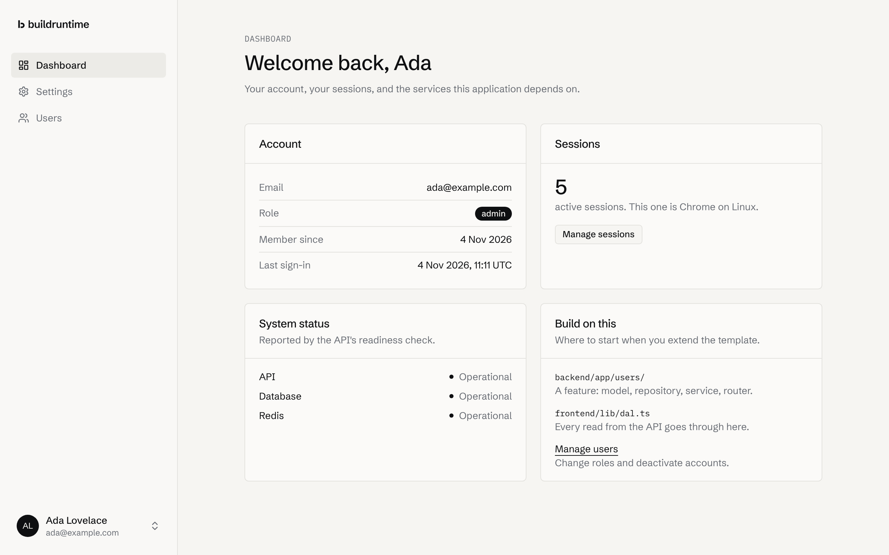
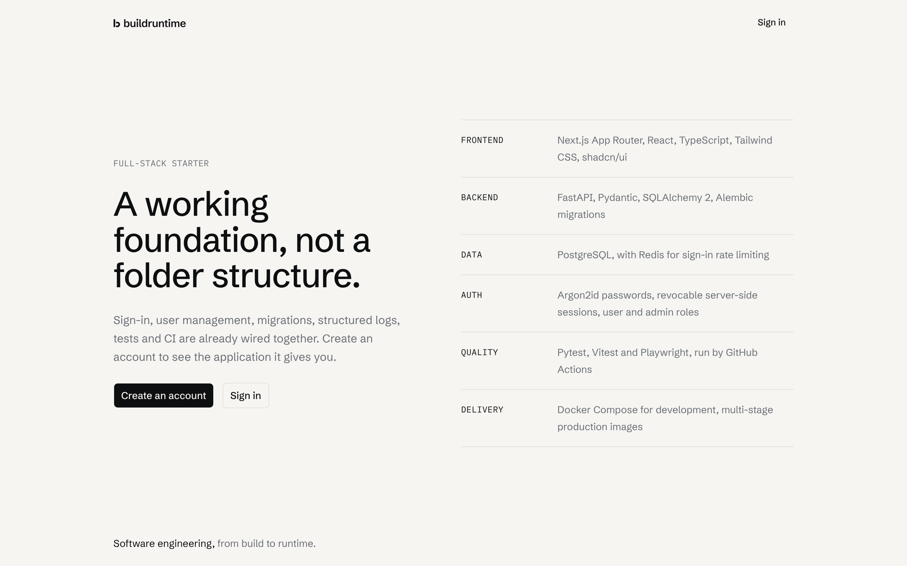
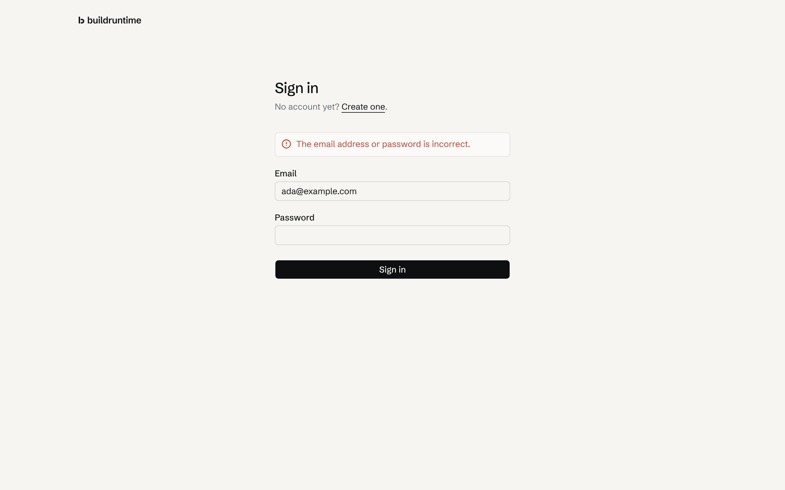
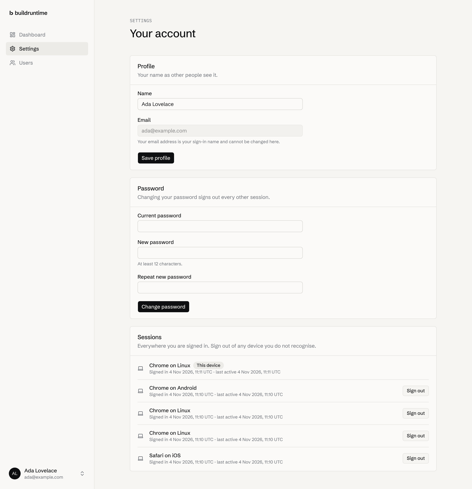
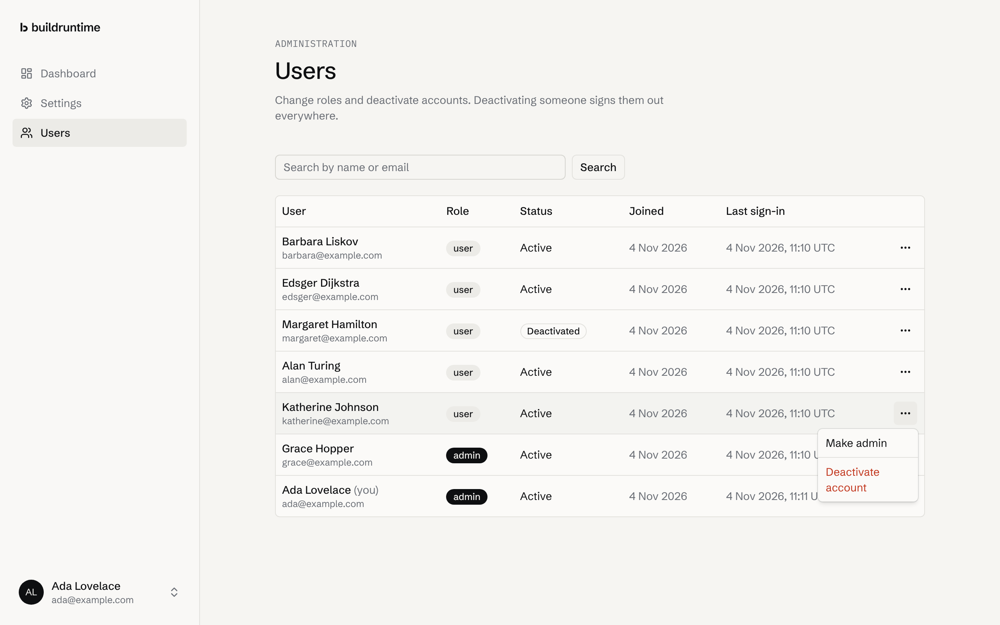
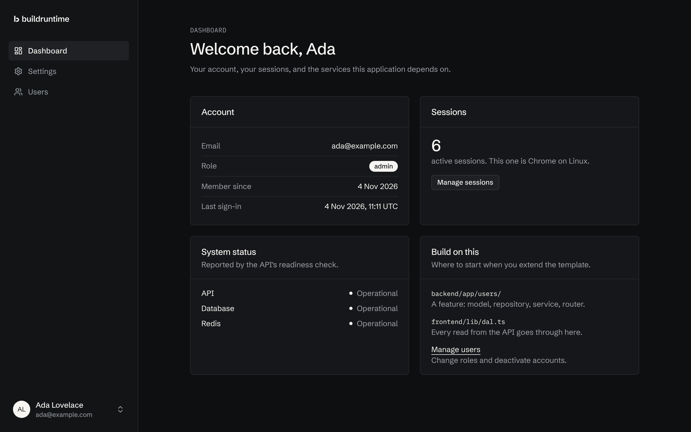
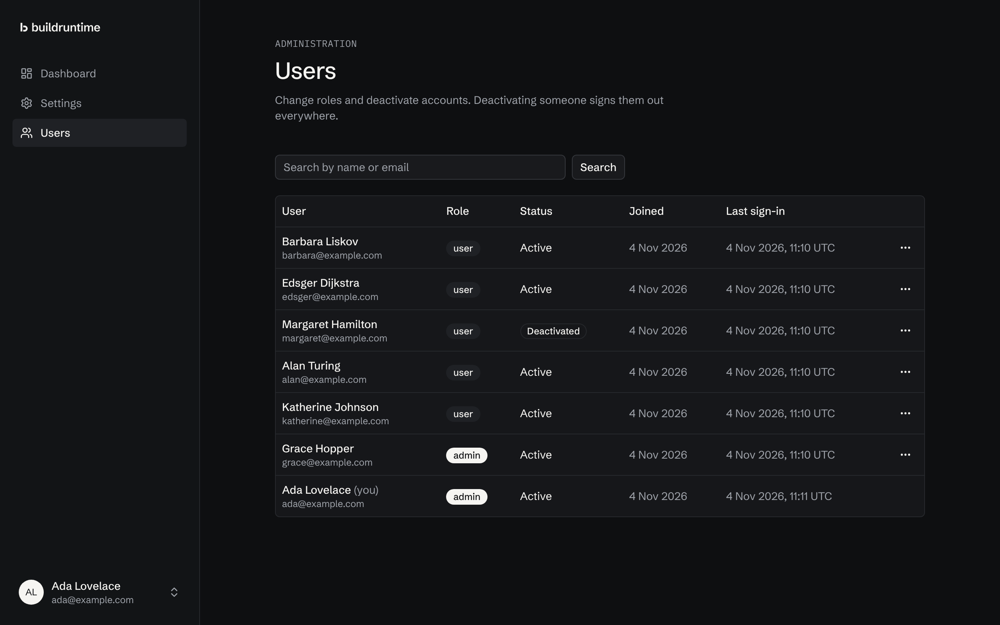
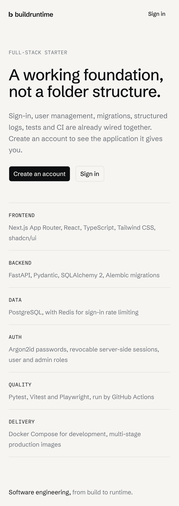
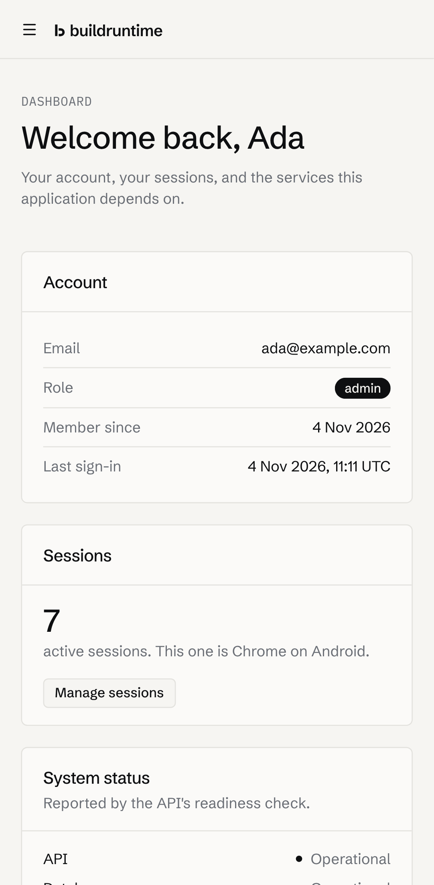
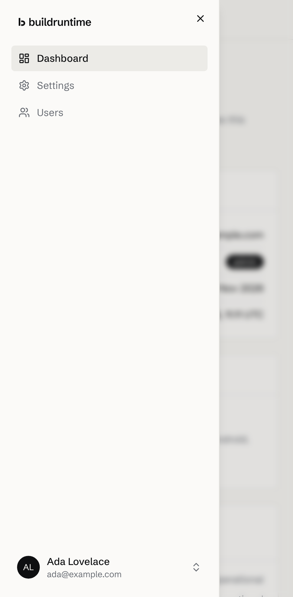

<picture>
  <source media="(prefers-color-scheme: dark)" srcset="https://raw.githubusercontent.com/buildruntime/buildruntime/main/assets/brand/logo-horizontal-dark.svg">
  
</picture>

# Full-stack starter: Next.js and FastAPI

A working starting point for web applications: a Next.js frontend and a FastAPI backend, with authentication, user management, PostgreSQL migrations, optional Redis, structured logging, tests at every level, Docker Compose and GitHub Actions already wired together.



## What you get

- **Authentication:** registration and sign-in, Argon2id password hashing, revocable server-side sessions in an HttpOnly `__Host-` cookie, sign-in rate limiting, and sign-out of one device or every device.
- **User management:** profile and password settings, a list of active sessions, and an admin area to search users, change roles and deactivate accounts, with self-lockout prevented.
- **A clean architecture:** routers, services and repositories in the API; a data access layer and Server Actions in the frontend; the API as the single authority for every permission check.
- **Validation and errors:** Pydantic and Zod at the boundaries, and errors in the Problem Details format (RFC 9457) with stable codes that the frontend maps to form messages.
- **Operations:** JSON logs with a request ID on every entry, liveness and readiness checks, and multi-stage Docker images that run as non-root users.
- **Tests:** 67 backend tests, 33 frontend unit tests and 22 end-to-end tests, all run by CI on every pull request.

## Stack

| Layer | Technology | Version |
| :-- | :-- | :-- |
| Frontend | Next.js (App Router), React, TypeScript | 16.4, 19.3, 5.9 |
| UI | Tailwind CSS, shadcn/ui (Radix), lucide-react | 4.3, CLI 4.23 |
| Backend | Python, FastAPI, Pydantic, SQLAlchemy, Alembic | 3.13, 0.162, 2.14, 2.1, 1.20 |
| Data | PostgreSQL, Redis (optional) | 17, 7 |
| Testing | pytest, Vitest, Playwright with axe | 9.2, 5.1, 1.64 |
| Tooling | uv, Ruff, mypy (strict), ESLint, Prettier | |
| Delivery | Docker Compose, GitHub Actions, Dependabot | |

Versions are pinned in `backend/uv.lock` and `frontend/package-lock.json`. TypeScript stays on 5.9 and ESLint on 9 because `typescript-eslint` and the React ESLint plugins do not support TypeScript 7 or ESLint 10 yet.

## Quick start

You need [Docker](https://docs.docker.com/get-started/get-docker/) with Compose. Nothing else.

```bash
git clone https://github.com/buildruntime/template-fullstack-nextjs-fastapi.git my-app
cd my-app
cp .env.example .env
```

Set a database password in `.env`. Compose refuses to start without one:

```bash
sed -i.bak "s/^POSTGRES_PASSWORD=$/POSTGRES_PASSWORD=$(openssl rand -hex 24)/" .env && rm .env.bak
```

Start everything, and wait until it is healthy:

```bash
docker compose up --build --wait
```

Open <http://localhost:3000> and create an account. The API and its interactive documentation are at <http://localhost:8000/docs>.

To give yourself the admin role, create an administrator from the command line. It asks for a password:

```bash
docker compose exec api python -m app.cli create-user --email you@example.com --name "Your Name" --role admin
```

Stop with `docker compose down`. Add `--volumes` to delete the database as well.

## Development

For day-to-day work, run PostgreSQL and Redis in Docker and the two applications on your machine, with reload. You need [uv](https://docs.astral.sh/uv/) and Node.js 24.

```bash
docker compose up -d db redis
```

The backend, in one terminal. Replace the placeholder in `backend/.env` with your `POSTGRES_PASSWORD`:

```bash
cd backend
cp .env.example .env
uv sync
uv run alembic upgrade head
uv run uvicorn app.main:create_app --factory --reload --port 8000
```

The frontend, in another:

```bash
cd frontend
cp .env.example .env.local
npm ci
npm run dev
```

The frontend is at <http://localhost:3000> and calls the API at `API_URL`.

## Tests

The backend's integration tests need a database they may wipe. Create one with the same password as in `backend/.env`:

```bash
docker compose exec db createdb -U starter starter_test
```

```bash
cd backend
uv run ruff format --check . && uv run ruff check .
uv run mypy app tests migrations
uv run pytest                        # Everything: unit and integration
uv run pytest tests/unit             # Unit tests only, no services needed
```

```bash
cd frontend
npm run format:check && npm run lint && npm run typecheck
npm test                             # Vitest unit tests
npm run build
```

End-to-end tests run against a production build, with the API running and an administrator account. Create the account with the CLI, then:

```bash
cd frontend
npx playwright install --with-deps chromium
npm run build
API_URL=http://localhost:8000 E2E_ADMIN_EMAIL=you@example.com E2E_ADMIN_PASSWORD='...' npm run test:e2e
```

| Suite | What it covers |
| :-- | :-- |
| `backend/tests/unit` | Services against in-memory fakes: registration, sign-in, sessions, password changes, admin rules, password hashing, logging, cursors. |
| `backend/tests/integration` | The HTTP API against real PostgreSQL and Redis: every endpoint, validation, authorisation, rate limiting, error responses, health checks. |
| `frontend/lib/*.test.ts` | Redirect safety, Problem Details parsing, validation rules, formatting. |
| `frontend/e2e` | Full flows in Chromium: sign-up, sign-in, sessions, password change, admin actions, authorisation, forms without JavaScript, a phone layout, and axe accessibility checks in light and dark themes. |

## Project structure

```text
.
├── backend/
│   ├── app/
│   │   ├── main.py            # Application factory and lifespan
│   │   ├── cli.py             # create-user, prune-sessions
│   │   ├── core/              # Settings, errors, logging, security, rate limiting
│   │   ├── db/                # SQLAlchemy base and session dependency
│   │   ├── api/               # Dependencies, error responses, middleware, health
│   │   ├── auth/router.py     # /v1/auth: register, login, logout
│   │   └── users/             # Models, repositories, services, schemas, /v1/users
│   ├── migrations/            # Alembic
│   ├── tests/                 # unit/ and integration/
│   └── Dockerfile
├── frontend/
│   ├── app/                   # Routes: (auth) and (app) groups, Server Actions
│   ├── components/            # Brand, shell, forms; ui/ from shadcn/ui
│   ├── lib/                   # Data access layer, API client, session, validation
│   ├── e2e/                   # Playwright tests
│   ├── proxy.ts
│   └── Dockerfile
├── docs/                      # Architecture, deployment, screenshots
├── compose.yaml
└── .github/                   # CI workflow and Dependabot
```

## Building on the template

- **A new backend feature:** copy the shape of `backend/app/users/`: a model, a repository, a service with the rules, schemas and a router. Generate a migration with `uv run alembic revision --autogenerate -m "..."` and read it before committing.
- **A new page:** add it under `frontend/app/(app)/`, read data through a new function in `lib/dal.ts`, and change data with a Server Action that calls the API through `authedApi`.
- **A new UI component:** `npx shadcn@latest add <component>` from `frontend/`.
- **A new role or permission:** add the role to the `Role` enum, the check constraint and the migration, then add a dependency like `require_admin` in `backend/app/api/deps.py`.

## Screenshots

| | |
| :-- | :-- |
|  |  |
|  |  |
|  |  |

| | | |
| :-- | :-- | :-- |
|  |  |  |

## Documentation

- [Architecture](docs/architecture.md): how the parts fit together, the authentication design, and the decisions behind them.
- [Deployment](docs/deployment.md): images, configuration, migrations, scaling and a checklist for going live.

## Licence

[MIT](LICENSE).
