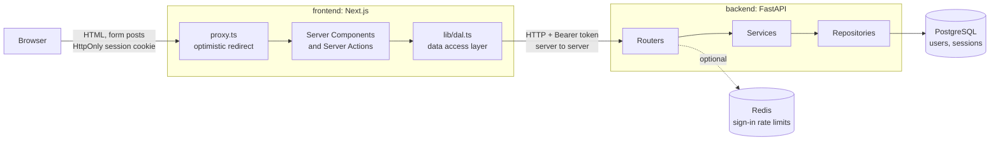
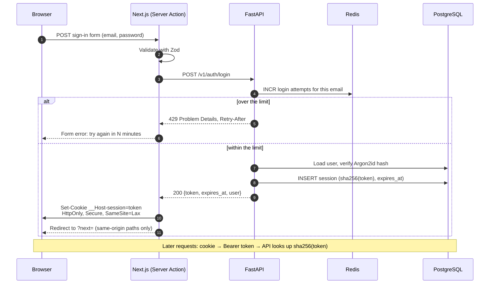
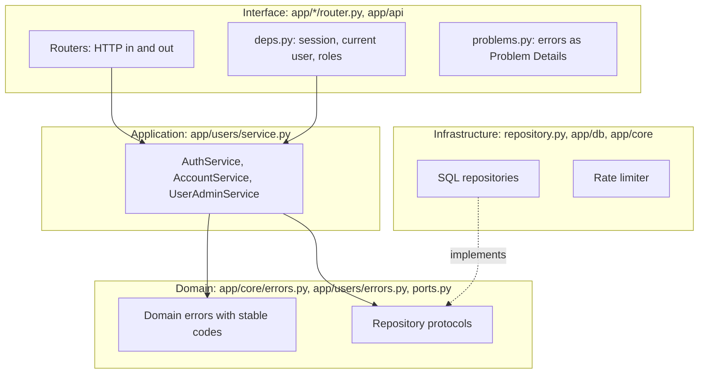
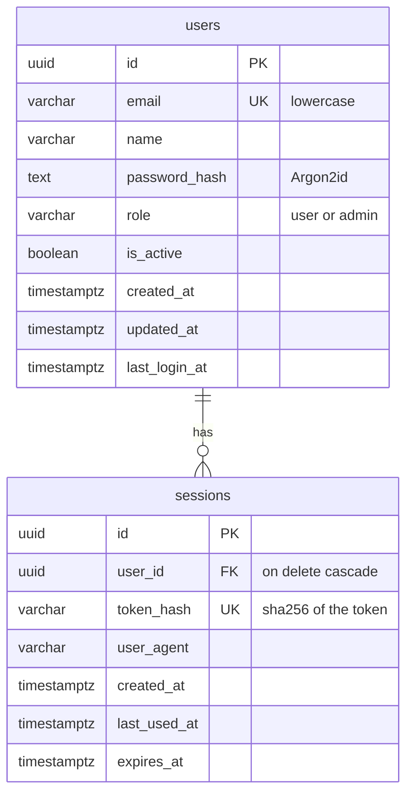

# Architecture

How the template fits together, and why it is built this way. The conventions follow the [Buildruntime engineering handbook](https://github.com/buildruntime/engineering-handbook).

## System



- **The browser talks only to Next.js.** It never calls the API. Pages render on the Next.js server, and forms submit to Server Actions, which call the API on the user's behalf. The API can therefore sit on a private network, needs no CORS configuration, and never sees a cookie.
- **The API is the only authority.** Every request carries the user's session token, and the API checks it, and the user's role, every time. Hiding a link in the interface is a convenience, not access control.
- **PostgreSQL holds everything that matters**, including sessions. Redis holds only rate-limit counters, which are acceptable to lose. Without Redis the application still works, with rate limiting disabled.

## Authentication

Sign-in creates a server-side session. The token is random, shown to the client once, and stored only as a SHA-256 hash.



| Decision | Why |
| :-- | :-- |
| Opaque, server-side sessions rather than JWTs | They can be revoked: signing out, changing a password and deactivating an account all take effect on the next request. |
| Only a hash of the token is stored | A copy of the database does not contain usable sessions. The token has 256 bits of entropy, so a fast hash is enough. |
| Argon2id for passwords | The current recommendation (RFC 9106), with parameters from `argon2-cffi`. Hashes are upgraded on sign-in when the parameters change. |
| `__Host-` cookie, HttpOnly, SameSite=Lax | JavaScript cannot read the token, subdomains cannot set or overwrite it, and it is not sent on cross-site form posts. Server Actions also check the `Origin` header. |
| The same error for an unknown email and a wrong password | It does not reveal which addresses have accounts. An unknown address is checked against a dummy hash, so both take as long. |
| Rate limiting per email address, in Redis | Slows down password guessing against one account from many addresses. Limiting per client address belongs at the edge (load balancer or WAF), where the real address is known. |
| Fail open if Redis is down | A Redis outage should not stop everyone signing in. It is logged as an error. |

Registration is open by default. Set `APP_ALLOW_REGISTRATION=false` to close it, and create accounts with the CLI. The registration endpoint reveals whether an email address is in use (`409 email_taken`). That is the usual trade-off for a self-service sign-up form. Close registration if it matters for your application.

## Authorisation

Two roles: `user` and `admin`. The API enforces them with FastAPI dependencies:

- `CurrentDep` requires a valid session, and gives the route the user and the session.
- `AdminDep` additionally requires the `admin` role, and returns `403` otherwise.
- Services enforce rules that depend on the data: users can only revoke their own sessions, and administrators cannot demote or deactivate themselves, so that the last administrator cannot lock everyone out.

In the frontend, `requireAdmin()` makes admin pages respond with the not-found page to everyone else. The page never fetches admin data for them, because the role check comes first, and the API would refuse it anyway.

## Backend layers



- **Routers are thin.** They validate input with Pydantic, call one service method and shape the response.
- **Services hold the rules** and depend on repository protocols, so unit tests run them against in-memory fakes (`tests/fakes.py`), with no database.
- **Domain errors carry a code and no HTTP status.** `app/api/problems.py` maps them to responses in the [Problem Details](https://www.rfc-editor.org/rfc/rfc9457) format, so the frontend can branch on `code`.
- **One transaction per request.** The session dependency commits when the route succeeds and rolls back when it raises. It is declared with `scope="function"`, so that the commit happens before the response is sent. With FastAPI's default scope, a failed commit would follow a successful response.

## Frontend

| Path | Role |
| :-- | :-- |
| `app/(auth)/` | Sign-in and registration, with their Server Actions. |
| `app/(app)/` | Signed-in pages and their Server Actions, inside the application shell. |
| `lib/dal.ts` | The data access layer: every read from the API. |
| `lib/actions.ts`, `lib/session.ts` | Server Action helpers and the session cookie. |
| `lib/api/` | The API client, Problem Details parsing and Zod schemas for responses. |
| `components/ui/` | shadcn/ui components, added with the shadcn CLI. |
| `proxy.ts` | Redirects to sign-in when there is no session cookie at all. |

- **Server Components fetch data**, through `lib/dal.ts`. Responses are validated with Zod where they enter the application.
- **Forms submit to Server Actions** with `useActionState`. Expected errors come back as form state; unexpected ones are thrown to `error.tsx`.
- **The shell streams.** The navigation and account menu depend on the user, so they render behind `<Suspense>` with skeletons, and the rest of the shell renders at once.

### Why Cache Components are off

`create-next-app` 16.4 enables `cacheComponents` and `partialPrefetching`. The template switches them off. With them on, a Server Action form submitted before the page had hydrated, or with JavaScript disabled, rendered a blank page instead of the result. The end-to-end suite found this: Playwright can submit a form before hydration finishes, as a user on a slow connection can. Sign-in has to work in that case, so `e2e/progressive-enhancement.spec.ts` now submits forms with JavaScript disabled.

The code already follows the Cache Components rules: session reads sit behind `<Suspense>`, and nothing depends on the old caching defaults. Turning it back on is a one-line change in `next.config.ts`. Run that test when you do.

Pages stream content behind `<Suspense>`, which React reveals with JavaScript, so the application as a whole needs JavaScript. The forms do not.

## Logging

The API logs one JSON object per line to standard output (`APP_LOG_FORMAT=json`), or readable lines in development (`console`).

- Every request gets an ID, from a valid `X-Request-ID` header or a new one. It is returned in `X-Request-ID`, included in error responses, and attached to every log entry for that request.
- One access log entry per request, with method, path, status, duration and user ID. Uvicorn's own access log is turned off to avoid duplicates.
- Expected errors are logged at `INFO` with their code. Unexpected ones are logged once, at `ERROR`, with the stack trace, and the client gets a generic message.
- Passwords, tokens and request bodies are never logged.

```json
{"time": "2026-11-04T11:10:42.118+00:00", "level": "INFO", "logger": "app.access", "message": "POST /v1/auth/login 200", "request_id": "6956c9269e15465eb6ddbd5cb45cccc6", "method": "POST", "path": "/v1/auth/login", "status": 200, "duration_ms": 88.4, "user_id": null}
```

## Data model



Constraints are named by convention (`uq_users_email`, `ck_users_role`, `fk_sessions_user_id_users`). Migrations live in `backend/migrations/versions/`, and CI fails if they do not match the models (`alembic check`). Expired sessions are removed with `python -m app.cli prune-sessions`. Run it on a schedule in production.
